# Kafka & Spring Cloud — Real-Time Analytics


## Présentation

Ce projet a été réalisé dans le cadre de l'activité pratique
N°4 du module Architecture Microservices, encadré par
le professeur Mohamed YOUSSFI à l'EMSI.

L'objectif est de mettre en pratique les architectures
événementielles avec Apache Kafka, Spring Cloud Stream
et Kafka Streams, puis de visualiser les résultats
dans un dashboard Angular actualisé en temps réel.

## Objectifs pédagogiques

- Installer et configurer Apache Kafka et ZooKeeper.
- Déployer Kafka avec Docker Compose.
- Comprendre les concepts de Producer et Consumer.
- Utiliser Spring Cloud Stream.
- Générer automatiquement des événements.
- Traiter des flux de données avec Kafka Streams.
- Exposer les résultats via une API REST.
- Visualiser les statistiques avec Angular et Chart.js.

## Technologies utilisées

| Technologie | Utilisation |
|---|---|
| Java 17 | Version cible du backend |
| Spring Boot 3.3.5 | Backend |
| Spring Cloud Stream | Communication événementielle |
| Apache Kafka | Message Broker |
| Kafka Streams | Traitement des flux |
| ZooKeeper | Coordination Kafka |
| Docker Compose | Infrastructure |
| Angular 19 | Frontend |
| TypeScript | Logique frontend |
| Bootstrap 5 | Interface responsive |
| Chart.js 4 | Visualisation des données |
| RxJS | Actualisation automatique |

## Architecture

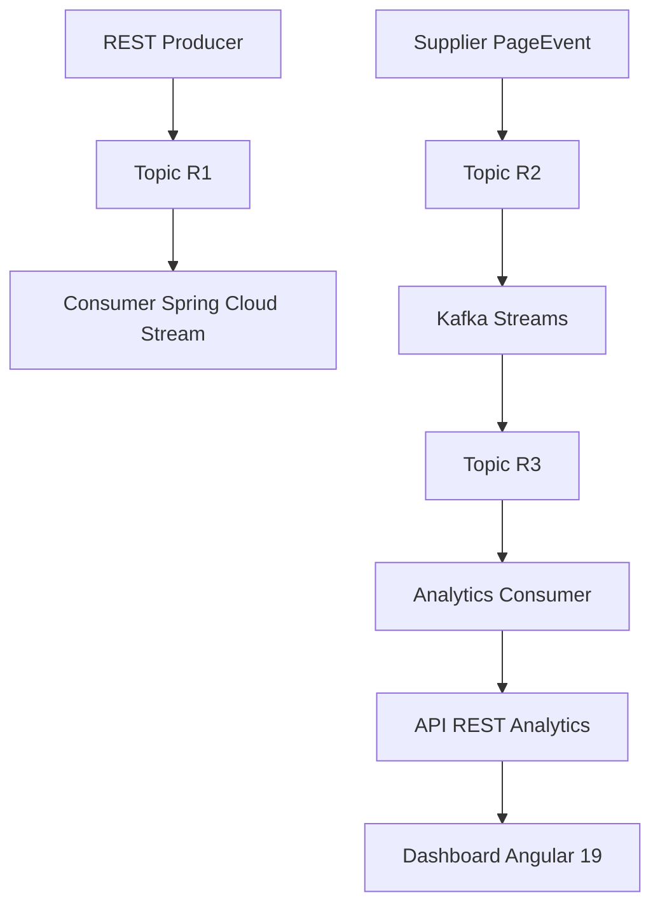

## Topics Kafka

| Topic | Description |
|---|---|
| R1 | Messages envoyés par le Producer REST |
| R2 | Événements PageEvent au format JSON |
| R3 | Résultats agrégés par Kafka Streams |

## Structure du projet

```text
kafka-spring-cloud-tp4/
├── kafka-docker/
│   └── docker-compose.yml
├── kafka-streams-app/
│   ├── src/
│   ├── pom.xml
│   └── mvnw.cmd
├── kafka-analytics-dashboard/
│   ├── src/
│   ├── angular.json
│   └── package.json
├── screenshots/
├── .gitignore
└── README.md
```

## Prérequis

- JDK 17
- Docker Desktop
- Node.js compatible avec Angular 19
- npm
- Git

## Installation et démarrage

### 1. Infrastructure Kafka

```bash
cd kafka-docker
docker compose up -d
docker compose ps
```

### 2. Backend Spring Boot

```powershell
cd kafka-streams-app
.\mvnw.cmd clean compile
.\mvnw.cmd spring-boot:run
```

Le backend est accessible sur :

http://localhost:8085

### 3. Frontend Angular

```bash
cd kafka-analytics-dashboard
npm ci
npm start
```

Le dashboard est accessible sur :

http://localhost:4200

## API REST

### Publier un message

```http
GET /publish/R1/BonjourKafka
```

Exemple :

http://localhost:8085/publish/R1/BonjourKafka

### Consulter les statistiques

```http
GET /analytics
```

Exemple de réponse :

```json
{
  "P1": 120,
  "P2": 98,
  "P3": 145,
  "P4": 110,
  "P5": 132
}
```

## Fonctionnalités

### 1. Kafka en local

Installation de Kafka et ZooKeeper, création
d'un topic et test Producer/Consumer.

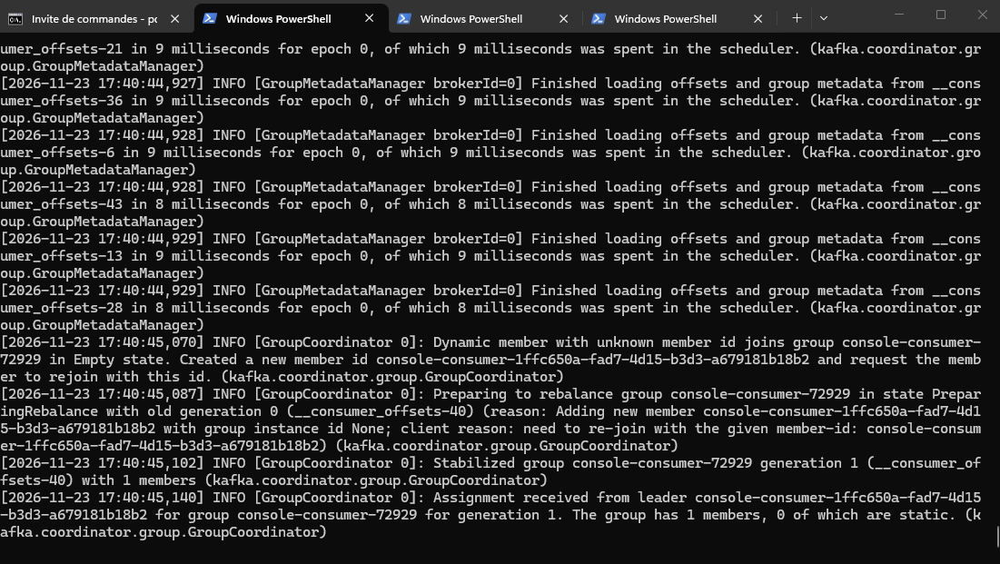

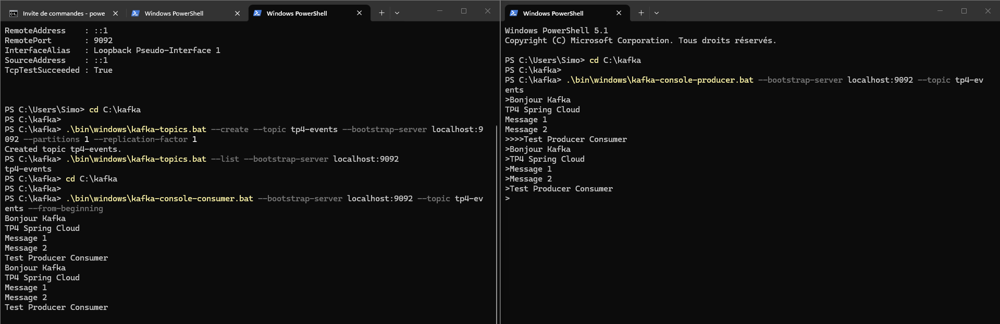

### 2. Kafka avec Docker

Déploiement de Kafka et ZooKeeper avec Docker Compose.

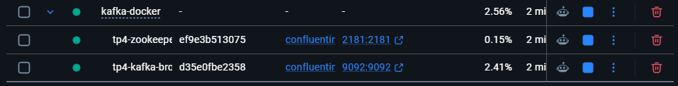

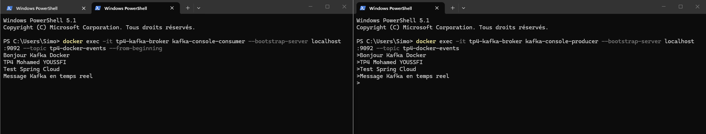

### 3. Producer REST

Publication de messages dans Kafka via StreamBridge.


### 4. Consumer

Consommation des messages du topic R1.

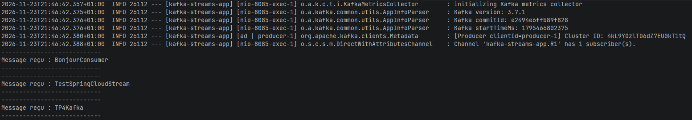

### 5. Supplier

Génération automatique d'événements dans le topic R2.

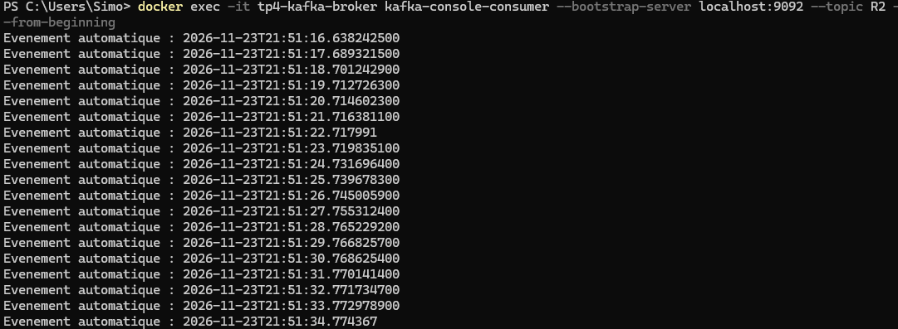

### 6. Kafka Streams Data Analytics

Traitement des événements et calcul du nombre
de visites pour chaque page.

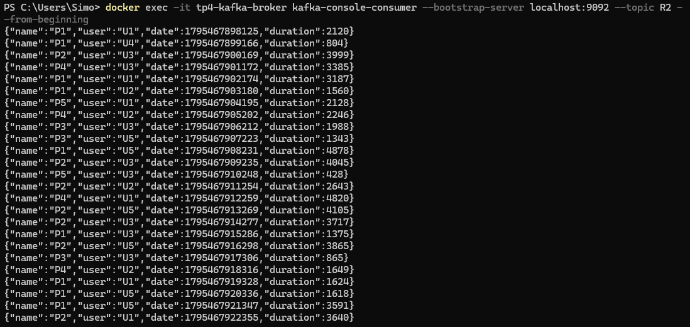

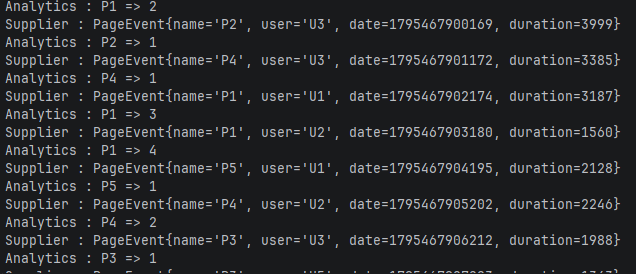

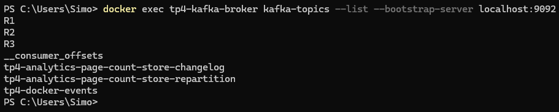

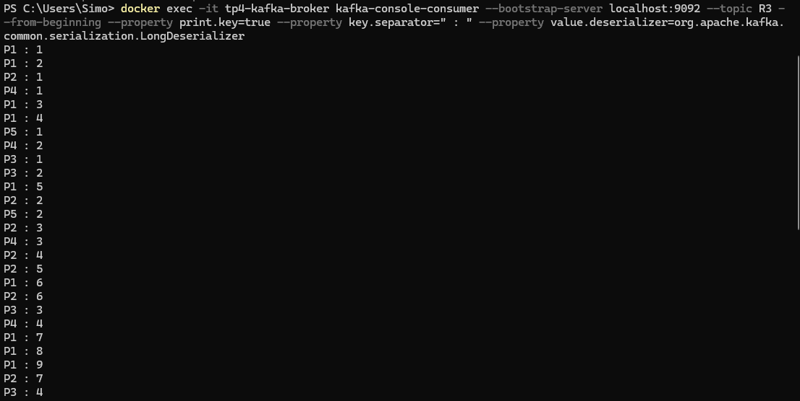

### 7. API REST Analytics

Exposition des statistiques calculées par Kafka Streams.

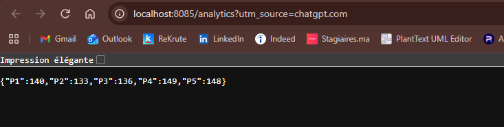

### 8. Dashboard Angular 19

Le dashboard permet de visualiser :

- Le nombre total de visites.
- Le nombre de pages actives.
- La page la plus visitée.
- Un graphique à barres.
- Un graphique circulaire.
- Un tableau détaillé des statistiques.
- L'état de connexion au backend.

Les données sont actualisées automatiquement
chaque seconde avec RxJS et HttpClient.

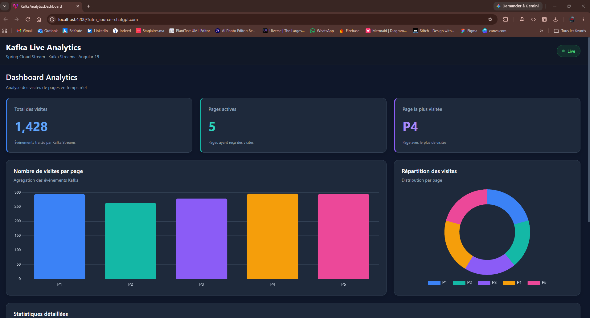

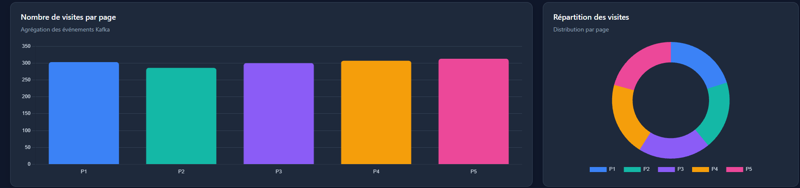

### Gestion de la déconnexion

Le dashboard détecte l'indisponibilité du backend
et se reconnecte automatiquement lorsque celui-ci
est de nouveau accessible.

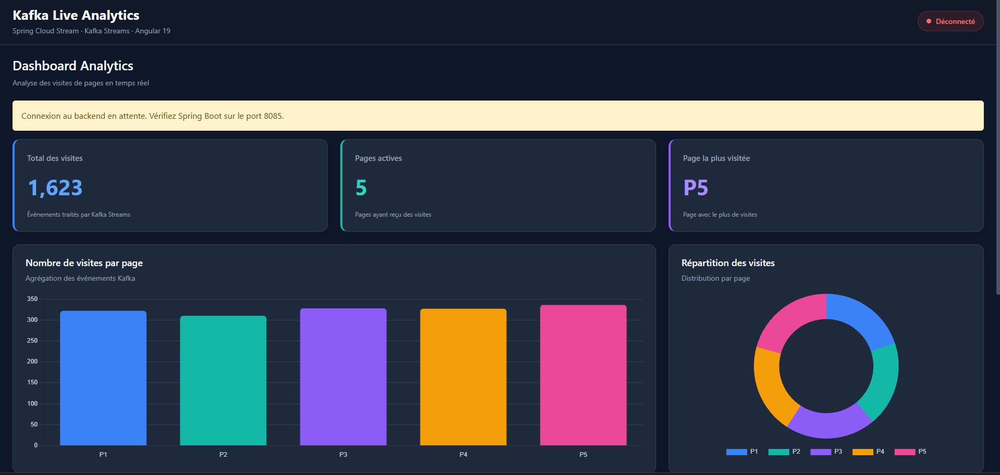

### Interface responsive

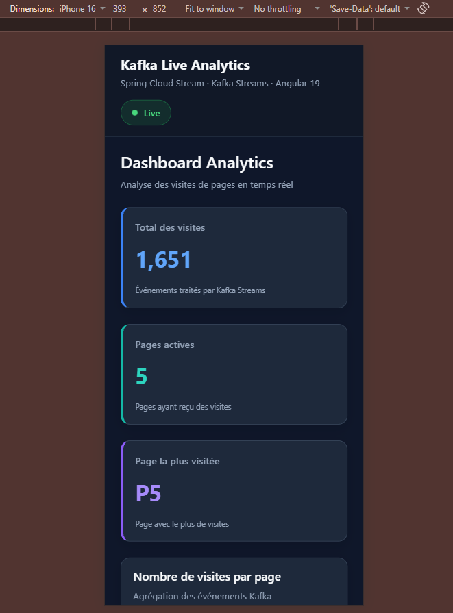

## Ports utilisés

| Service | Port |
|---|---|
| ZooKeeper | 2181 |
| Kafka Broker | 9092 |
| Spring Boot | 8085 |
| Angular | 4200 |

## Compétences acquises

- Architecture événementielle.
- Communication asynchrone.
- Spring Cloud Stream et programmation fonctionnelle.
- Sérialisation et désérialisation Kafka.
- Traitement et agrégation de flux.
- Développement d'API REST.
- Visualisation dynamique des données.
- Conteneurisation avec Docker.

## Auteur

**Mohamed Yawina**

Étudiant en dernière année d'ingénierie informatique
et réseaux — EMSI.

GitHub : https://github.com/mohamed-yawina

## Encadrement

**Professeur Mohamed YOUSSFI**

Activité pratique N°4 — Kafka et Spring Cloud

## Contexte

Projet académique réalisé à des fins pédagogiques.
